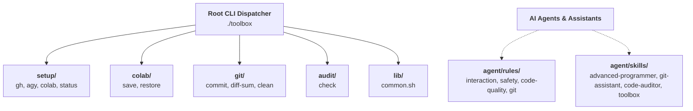

# AGENTS.md — Repository Guidance for Autonomous AI Assistants

Welcome to `toolbox`. This file serves as the definitive operating manual and behavioral specification for AI coding assistants (Antigravity, Claude, Cursor, Codex) working within this repository.

---

## 1. System Architecture & Mental Model

`toolbox` is a standalone, polyglot developer and AI agent toolkit designed to run anywhere with zero mandatory external dependencies.



### Key Principles
- **Dynamic Auto-Discovery**: Every executable script placed in `tools/<category>/` with a `# Description:` header is dynamically registered by `./toolbox`.
- **Zero Global Dependency Requirement**: Core utilities run on standard Bash + POSIX utilities without requiring global pip package installations.
- **Strict Category Namespacing**: Commands are invoked via `./toolbox <category> <command> [args...]`.

---

## 2. Quick Verification Runbook

Always verify repository health before and after completing any work:

```bash
# Run comprehensive code, syntax, permission, and security audit
./toolbox audit check

# Check working tree diffs and untracked file status
./toolbox git diff-sum

# Test top-level CLI dispatcher auto-discovery
./toolbox --help

# Test category commands
./toolbox setup status
./toolbox colab --help
./toolbox git --help
```

---

## 3. Non-Negotiable Red Lines

1. **The Zero-Guessing Rule ("Grill, Don't Guess")**:
   - If user instructions contain ambiguity, multiple architectural paths, or unstated preferences, **never assume**. Pause and use the question tool (`ask_question`) to interrogate and align on the decision.
2. **Three-Phase Interaction Protocol**:
   - **Exploring**: Mentor with deep architectural context and trade-offs.
   - **Planning**: Grill like a devil's advocate before starting implementation.
   - **Implementing**: Execute direct, razor-sharp, with zero conversational fluff.
3. **Zero Secret & Credential Leaks**:
   - Never print, hardcode, log, or commit tokens (`gho_*`, `ghp_*`), OAuth credentials, private keys, or passwords.
   - Rely strictly on environment variables or secure storage (e.g., Google Colab Userdata).
4. **No Unchecked Unwraps or Swallowed Errors**:
   - Never catch errors without logging or handling them.
   - No `.unwrap()` or `.expect()` in production systems code.
5. **Ask Before Destructive Operations**:
   - Overwriting non-temporary files, force-pushing, or deleting directories requires explicit user confirmation.
6. **Documentation Integrity**:
   - When updating features, update `README.md`, `CHANGELOG.md`, and relevant skills concurrently.

---

## 4. Directory Sitemap & Responsibilities

```
toolbox/
├── toolbox                      # Unified root CLI dispatcher (auto-discovers tools)
├── AGENTS.md                    # This operating specification for AI agents
├── CHANGELOG.md                 # Semantic version history (Keep a Changelog)
├── README.md                    # User manual, quick starts, and reference tables
├── tools/                       # Category-namespaced executable CLI tools
│   ├── lib/
│   │   └── common.sh           # Sourced helper library (colors, logging, prompts)
│   ├── setup/                  # Environment bootstrapping
│   │   ├── status              # Non-destructive credentials & mount auditor
│   │   ├── colab               # One-click Drive mount, gh login, agy restore
│   │   ├── gh                  # GitHub CLI login via Colab Secrets (GH_TOKEN)
│   │   └── agy                 # Backup/restore Antigravity OAuth tokens
│   ├── colab/                  # Cloud runtime persistence
│   │   ├── save                # Backup dotfiles/configs to Google Drive tarball
│   │   └── restore             # Restore files from Google Drive tarball
│   ├── git/                    # Git workflow helpers
│   │   ├── diff-sum            # Working tree summary with change stats
│   │   ├── commit              # Smart Conventional Commit authoring tool
│   │   └── clean               # Safe cache & temporary file cleaner
│   └── audit/                  # Repository auditing
│       └── check               # Static bash syntax, permissions, and secret scanner
└── agent/                       # Agent intelligence assets
    ├── rules/                  # Behavioral and coding rulesets
    │   ├── interaction.md      # 3-Phase collaboration and zero-guessing rules
    │   ├── safety.md           # Safety, credential protection, and autonomy boundaries
    │   ├── code-quality.md     # Polyglot, systems (Rust/C), and documentation standards
    │   └── git.md              # Conventional Commits and atomic diff hygiene
    └── skills/                 # Antigravity agent skills
        ├── toolbox/            # Skill for managing and executing toolbox commands
        ├── git-assistant/      # Git hygiene, diff analysis, and commit crafting
        ├── code-auditor/       # Static code quality and secret detection
        └── advanced-programmer/# Senior full-stack & systems engineering standards
```

---

## 5. Adding or Modifying Tools

To add a new tool:
1. Choose an appropriate category under `tools/<category>/` (or create a new category folder).
2. Create the executable script:
   ```bash
   #!/usr/bin/env bash
   # Description: <Brief one-line summary for auto-discovery>
   set -eo pipefail
   TOOLBOX_ROOT="$(cd -P "$(dirname "${BASH_SOURCE[0]}")/../.." >/dev/null 2>&1 && pwd)"
   source "${TOOLBOX_ROOT}/tools/lib/common.sh"
   # Implementation...
   ```
3. Grant execution permissions: `chmod +x tools/<category>/<command>`.
4. Run `./toolbox audit check` to ensure syntax, permissions, and security pass cleanly.
5. Document the tool in `README.md` and record the change in `CHANGELOG.md`.
