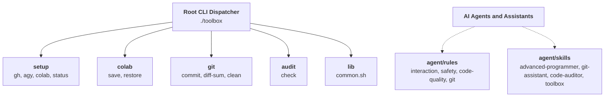

# AGENTS.md — Repository Guidance for Autonomous AI Assistants

Welcome to `toolbox`. This file serves as the definitive operating manual and behavioral specification for AI coding assistants working within this repository and across target projects.

---

## System Architecture and Mental Model

`toolbox` is a standalone, polyglot developer and AI agent toolkit designed to run anywhere with zero mandatory external dependencies.



### Key Principles
- **Dynamic Auto-Discovery**: Every executable script placed in `tools/<category>/` with a `# Description:` header is dynamically registered by `./toolbox`.
- **Zero Global Dependency Requirement**: Core utilities run on standard Bash and POSIX utilities without requiring global pip package installations.
- **Strict Category Namespacing**: Commands are invoked via `./toolbox <category> <command> [args...]`.

---

## Quick Verification Runbook

Always verify repository health before and after completing any work:

```bash
# Run comprehensive code, syntax, permission, and security audit
./toolbox audit check

# Check working tree diffs and untracked file status
./toolbox git diff-sum

# Test top-level CLI dispatcher auto-discovery
./toolbox --help

# Test category commands
./toolbox setup status
./toolbox colab --help
./toolbox git --help
```

---

## Non-Negotiable Red Lines

- **The Zero-Guessing Rule**: If user instructions contain ambiguity, multiple architectural paths, or unstated preferences, never assume. Pause and use the question tool to interrogate and align on the decision.
- **Three-Phase Interaction Protocol**:
  - **Exploring**: Mentor with deep architectural context and trade-offs.
  - **Planning**: Grill like a devil's advocate before starting implementation.
  - **Implementing**: Execute direct, razor-sharp, with zero conversational fluff.
- **Zero Secret and Credential Leaks**:
  - Never print, hardcode, log, or commit tokens, OAuth credentials, private keys, or passwords.
  - Rely strictly on environment variables or secure storage such as Google Colab Userdata.
- **No Unchecked Unwraps or Swallowed Errors**:
  - Never catch errors without logging or handling them.
  - No `.unwrap()` or `.expect()` in production systems code.
- **Ask Before Destructive Operations**:
  - Overwriting non-temporary files, force-pushing, or deleting directories requires explicit user confirmation.
- **Documentation Integrity**:
  - When updating features, update `README.md`, `CHANGELOG.md`, and relevant skills concurrently.

---

## Directory Sitemap and Responsibilities

```
toolbox/
├── toolbox                      # Unified root CLI dispatcher
├── AGENTS.md                    # Operating specification for AI agents
├── CHANGELOG.md                 # Semantic version history
├── CONTRIBUTING.md              # Contributor guide and PR standards
├── SECURITY.md                  # Vulnerability reporting policy
├── README.md                    # User manual and reference tables
├── tools/                       # Category-namespaced executable CLI tools
│   ├── lib/
│   │   └── common.sh           # Sourced helper library
│   ├── setup/                  # Environment bootstrapping
│   │   ├── status              # Credentials and mount auditor
│   │   ├── colab               # Drive mount, gh login, agy restore
│   │   ├── gh                  # GitHub CLI login via Colab Secrets
│   │   └── agy                 # Backup and restore Antigravity tokens
│   ├── colab/                  # Cloud runtime persistence
│   │   ├── save                # Backup dotfiles to Google Drive tarball
│   │   └── restore             # Restore files from Google Drive tarball
│   ├── git/                    # Git workflow helpers
│   │   ├── diff-sum            # Working tree summary with change stats
│   │   ├── commit              # Conventional Commit authoring tool
│   │   └── clean               # Safe cache and temp cleaner
│   └── audit/                  # Repository auditing
│       └── check               # Bash syntax, permissions, and secret scanner
└── agent/                       # Agent intelligence assets
    ├── rules/                  # Behavioral and coding rulesets
    │   ├── interaction.md      # Collaboration and zero-guessing rules
    │   ├── safety.md           # Safety, credential protection boundaries
    │   ├── code-quality.md     # Polyglot, systems, and doc standards
    │   └── git.md              # Conventional Commits and diff hygiene
    └── skills/                 # Antigravity agent skills
        ├── toolbox/            # Skill for toolbox command execution
        ├── git-assistant/      # Git hygiene and diff analysis
        ├── code-auditor/       # Static code quality and secret detection
        └── advanced-programmer/# Senior full-stack and systems standards
```

---

## Adding or Modifying Tools

To add a new tool:
1. Choose an appropriate category under `tools/<category>/` or create a new category folder.
2. Create the executable script:
   ```bash
   #!/usr/bin/env bash
   # Description: <Brief one-line summary for auto-discovery>
   set -eo pipefail
   TOOLBOX_ROOT="$(cd -P "$(dirname "${BASH_SOURCE[0]}")/../.." >/dev/null 2>&1 && pwd)"
   source "${TOOLBOX_ROOT}/tools/lib/common.sh"
   # Implementation...
   ```
3. Grant execution permissions: `chmod +x tools/<category>/<command>`.
4. Run `./toolbox audit check` to ensure syntax, permissions, and security pass cleanly.
5. Document the tool in `README.md` and record the change in `CHANGELOG.md`.
